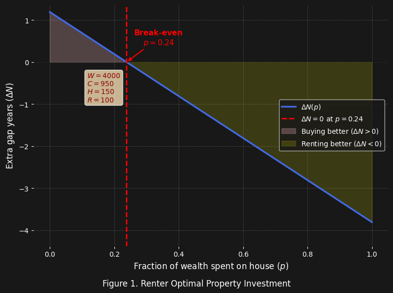
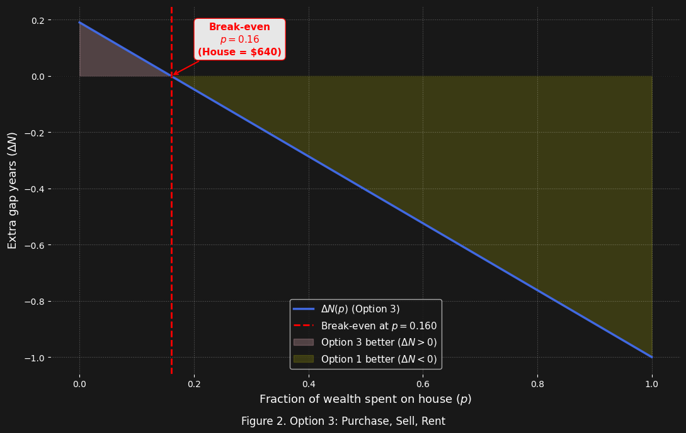
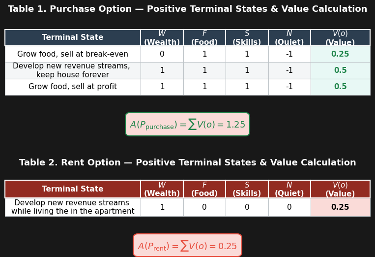
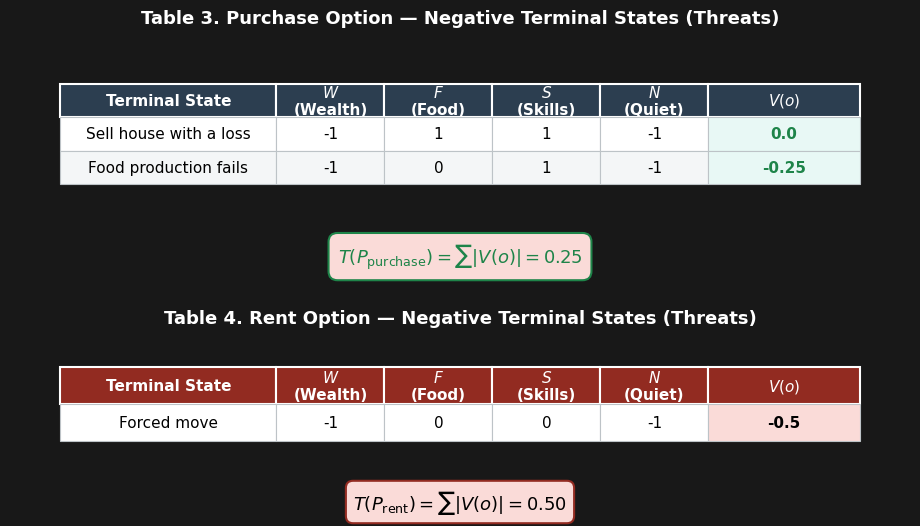
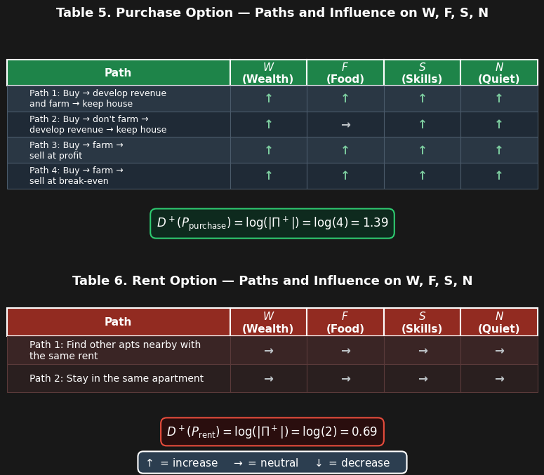
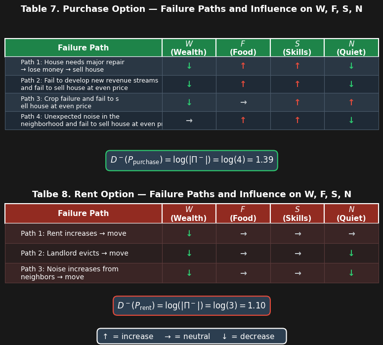
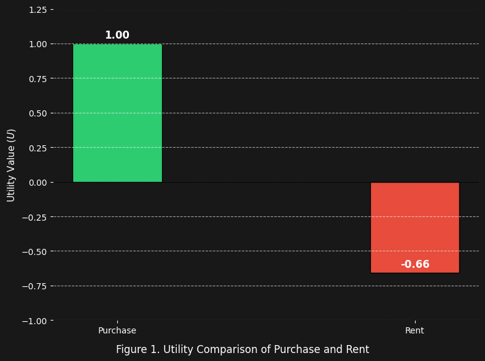
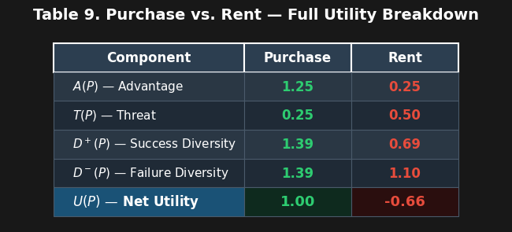

## Introduction ##

If you possess a specific amount of Cash ($W$), how can you better improve your position when you are faced with the following two choices:

+ Rent an apartment
+ Purchase a small house

In this article, we compare these two options by analyzing the "time" your wealth can buy in each scenario and the subsequent impact on the overall position.

## Basic Calculation for $\Delta N$ ##

To compare these options effectively, we calculate the duration for which the cash lasts in each scenario and determine the difference ($\Delta N$). 

The duration of wealth when renting ($N_{\text rent}$) and purchasing ($N_{\text purchase}$) are defined as follows:

$$
N_{\text rent} = \frac{W}{C+R}
$$

$$
N_{\text purchase} = \frac{(1-p)W}{(C-H)}
$$

Consequently, the difference in time ($\Delta N$) is calculated as:

$$
\Delta N = N_{\text purchase} - N_{\text rent}
= \frac{(1-p)W}{(C-H)} - \frac{W}{(C+R)}
$$

Where:
+ $N_{\text purchase}$: Number of years the remaining wealth can purchase after the property investment. 
+ $N_{\text rent}$: Number of years the original wealth can purchase

+ $p$: Percentage of wealth used to purchase a house and rennovate it
+ $W$: Total wealth (money in this case)
+ $C$: Cost of living
+ $H$: Total market value of housegrown food, such as veggies and eggs.
+ $R$: Rent
+ $\Delta N$: Number of extra years

To determine the maximum percentage of wealth that can be allocated to the property investment without reducing your financial runway, we set $\Delta N = 0$, and calculate $p$:

$$
p = \frac{R+H}{C+R}
$$

The above equation indicates that to increase p, we can increase the value of housegrown produce ($H$) and/or lower cost of living ($C$).

Now let's visualize an example:
+ $W=4000$
+ $C=950$
+ $H=150$
+ $R=100$

As shown in Figure 1, when the investment percentage  $p≤0.24$  (meaning the price of the house and renovation is ≤960 ), $\Delta N$ becomes positive. This implies that, given these specific wealth and cost-of-living parameters, purchasing a house allows you to sustain your wealth for a longer period than renting.

    

    

## Advanced Calculation of $\Delta N$ ##

When the cash runs out, Option 2 leaves us with residual net worth (the house), it unlocks a third pathway not available to the renter: selling the property to regain liquidity. This action extends your financial runway, creating the "gap time" - $N_{\text sell}$. This third option extends the second: it represents the additional years gained after selling the property purchased in the second option.

$$
\Delta N = N_{\text purchase} - N_{\text rent} + N_{\text sell} - N_{\text limit}
$$

Where:

+ $N_{\text limit}$: a threshold value representing the minimum number of years one must hold the property before selling to make it worthwhile. This term serves primarily to identify the advantage threshold — i.e. the break-even point that delineates where the advantage of purchasing begins to erode.

That leads us to:

$$
\Delta N = \frac{(1-p)W}{(C-H)} - \frac{W}{(C+R)} + a \cdot \frac{pW}{C+R} - N_{\text limit}
$$

$$
\Delta N = \frac{(1-p)W}{(C-H)} - \frac{W-apW}{(C+R)} - N_{\text limit}
$$

Where:
+ $a$: the appreciation (as a fraction) of the property.

Now let us apply these formulas to the previous example ($W=4000, C=950, H=150, R=100$), setting $N_{\text limit}=1$ and $a=1$ (i.e., the property price neither appreciates nor depreciates).

As shown in Figure 2, when **$p$ ≤ 0.16** (meaning the purchase and renovation cost of the house is ≤ 640 ), Option 3 provides more than one additional year compared to Option 1 (renting an apartment).

Although comparing renting versus purchasing through the time dimension is straightforward, these two choices have broader implications for our **overall position** — encompassing factors such as health, skills, and overall wealth. In the next section, we will compare these two options using the **utility function of position**.

    

    

## Define the Game ##

While $\Delta N$ captures the time dimencion of the options, a comprehensive comparison requires a broader perspective. We evaluate actions not by their immediate payoff, but by how they reshape the structure of reachable futures.

To formalize this comparison, we first define the game in order to establish what constitutes success or failure.

Following the framework, a game is defined as:

$$
G = (S, A, f, S_T, V)
$$

where:

+ $S$ = set of all admissible system states
+ $A(s)$ = set of legal actions available at state
+ $f$: $S \times A \to S \quad \text{(transition function)} $
+ $S_T$ $\subseteq S \quad \text{(terminal states)}$ 
+ $V : S_T \to \mathbb{R} \quad \text{(terminal value function)}$

In our game, the actions are:

$$
A(s) = \left\{ A_{\text{rent}}, A_{\text{purchase}} \right\}
$$

Each action transforms the current state into different terminal states:

$$
S'_{\text rent} = f(S, A_{rent})
$$

$$
S'_{\text purchase} = f(S, A_{purchase})
$$

The rational choice is the action that maximizes the utility gain:

$$
A^* = \arg\max_{A \in \{A_{\text{rent}}, A_{\text{purchase}}\}} \Delta U(P)
$$

Therefore:

$$
\text{Choose purchase} \iff U(P'_{\text{purchase}}) > U(P'_{\text{rent}})
$$

$$
\text{Choose rent} \iff U(P'_{\text{rent}}) > U(P'_{\text{purchase}})
$$

$$
\text{Indifferent} \iff U(P'_{\text{purchase}}) = U(P'_{\text{rent}})
$$

Now let's calculate the position utility for each action.

## Position Utility ##

To evaluate the quality of a position, the framework decomposes utility into four structural components: advantage, threat, success diversity, and failure diversity. Together, these yield the unified position utility:

$$
U(P) = A(P) - T(P) + D^{+}(P) - D^{-}(P).
$$

Where:
+ access to positive terminal value $A(P)$
+ exposure to negative terminal value $T(P)$
+ structural richness of success paths $D^{+}(P)$
+ structural fragility of failure paths $D^{-}(P)$

## Define Terminal State ##

In order to calculate the utility, first we need to define our terminal state ($S_T$) based on our goals:

$$
S_T = (W, F, S, N)
$$

Where:
+ $W$: Wealth (residual assets when cash runs out)
+ $F$: Number of food sources
+ $S$: Skills (such as property transaction, DIY skills)
+ $N$: Environmental noise level 

Note that $W$, $F$, and $S$ are benefits (higher is better), while $N$ is a cost (lower is better). This distinction matters when we assign values.

Next, we define the terminal value function $V$, which scores each terminal state $o$:

$$
V(o) = w_W \cdot W(o) + w_F \cdot F(o) + w_S \cdot S(o) - w_N \cdot N(o)
$$

Where $w$s reflect our personal priorities. In our folliwng calculation, we assign equal weights to each factor:

$$
w_W = 0.25, w_F  = 0.25, w_S = 0.25, w_N = 0.25
$$

As for the **current position $P$**, we set each criterion to zero:

$$P=(W,F,S,N)=(0,0,0,0)$$

This establishes a neutral baseline: any positive value represents an improvement over the status quo, and any negative value represents a deterioration.

## Calculation of Each Term ##

Here's how to instantiate each term for our rent vs. purchase problem:

## Advantage $A(P)$ ##

The sum of positive terminal values reachable from your position.

+ For purchase:

    + Grow food and sell house at break-even
    
    + Grow food, develop other revenues, keep house forever
    
    + Grow food and sell house at profit
    
    For all positive outcomes:
    
    $$A(P_{\text purchase}) = \sum V_p(o)$$ 

+ For rent:

    + Develop new revenue streams while living the in the same apartment
  
    For all positive outcomes:

    $$A(P_{\text rent}) = \sum V_r(o)$$

The calculation of $A(P)$ is shown in Tables 1 and 2. $A(p_{\text purchase})$ is 1.25, which is 5 times of $A_{\text rent}$ (0.25). This gap reflects two compounding effects.

First, purchase has more positive terminal states. Rent reaches only one positive state ("stay the same"), while purchase reaches three distinct states (sell at break-even, develop revenue and keep the house, sell at profit), providing us with more possibilities for the future.

Second, each of purchase's positive states is worth more or equal to rent's entire advantage:

$$
V_p(o_1), V_p(o_2), V_p(o_3) \geq A(P_{\text{rent}})
$$

Together, these two effects mean $A(P)$ captures something richer than simply "how good" a position is — **it captures how many ways you can be good, and how much each of those ways is worth.** This is the "structural richness" the utility function is designed to measure.

    

    

## Threat $T(P)$ ##

$T(P)$ is the sum of the magnitudes of all negative terminal values — that is, the total downside risk associated with each option.

+ For purchase:

    + Selling the house at a loss
      
    + Home-grown food production falling short of expectations

    Summing over all negative outcomes:

    $$T(P_{\text purchase}) = \sum |V_p(o)|$$

+ For rent:

    + Being forced to move out and find alternative housing

    Summing over all negative outcomes:

    $$T(P_{\text rent}) = \sum |V_r(o)|$$

The calculation of $T(P)$ is shown in Tables 3 and 4. $T(P_{\text purchase})$ is 0.25, which is half of $T(P_{\text rent})$ (0.5). This gap reflects an insight: although purchasing has more ways for things to go wrong, the worst-case outcome in each of those failure states is still better than what renting offers in its own failure states. In other words, purchasing provides a higher "floor" — greater downside protection — even when it fails.

    

    

### Success Diversity $D^+(P)$

$D^+(P)$ is the log of the number of distinct paths to a positive outcome. This metric captures not just whether success is possible, but how many structurally different routes can lead to it.

The calculated values of $D^+(P)$ are shown in Tables 5 and 6. We find that $D^+(P_{\text purchase})=1.39$, which is twice $D^+(P_{\text rent})=0.69$. This gap indicates that purchasing offers more distinct paths to success than renting — specifically, 4 versus 2. With more independent routes to a positive outcome, the purchase option provides a higher structural probability of success.

    

    

### Failure Diversity $D^−(P)$

$D^−(P)$ is the logarithm of the number of distinct paths leading to failure. Like its positive counterpart, this metric measures the structural variety of failure modes, rather than just their aggregate severity.

The calculated values of $D^-(P)$ are shown in Tables 7 and 8. We find that $D^−(P_{\text purchase})=1.39$ , slightly higher than $D^−(P_{\text rent})=1.10$. This difference arises because purchasing has four distinct paths to failure, while renting has three. This indicates that purchasing is slightly more complex and exposes you to more distinct downside scenarios, but the difference is small.

Importantly, this does not mean purchasing is riskier overall. Because $T(P_{\text purchase})$is much lower than $T(P_{\text rent})$ (0.25 vs. 0.5), each failure path in purchasing is less damaging. So while purchasing has more ways to go wrong, its failures are less severe — a key distinction between failure diversity and failure cost.

    

    

## Calculation of Utility ##

### Overall analysis

Based on the caculation of each term above, now we can calculate the utility value for each option (Table 9). As shown in Figure 1, Purchase's utility is significantly higher than rent's (1.00 vs. -0.66):

$$
U(P'_{\text{purchase}}) > U(P'_{\text{rent}})
$$

It means that purchase is the structurally superior option — not just in one dimension (e.g. $\Delta N$), but across the full geometry of reachable futures.

    

    

    

    

### Decomposition and action guide

From Table 9, we can see how the four utility terms compare:

+ $A(P)$ — purchase is higher: it reaches more total positive value.
+ $T(P)$ — purchase is lower: it is exposed to less total threat magnitude than rent.
+ $D^+(P)$ — purchase is higher: it has more distinct paths to success.
+ $D^-(P)$ — purchase is higher: it has more distinct paths to failure.

In short, purchase wins on upside ($A(P)$), carries less risk ($T(P)$), and offers more ways to succeed ($D^+(P)$), though it does present slightly more ways to fail ($D^−(P)$). The net utility is strongly positive because the combination of higher upside and lower threat outweighs the added failure diversity.

Two deeper implications emerge from this decomposition.

First, the asymmetry in **downside protection**. The fact that $T(P_{\text purchase})$ is half of $T(P_{\text rent})$ reveals a critical structural advantage: even in its worst failure states, purchasing retains a residual asset (the house) that renting cannot match. This aligns with the **maximum-minimum principle** in Game Theory, which advises choosing the strategy that maximizes the minimum possible payoff. Purchasing doesn't just raise the ceiling, it raises the floor. For long-term financial stability, this downside protection may matter more than the upside.

Second, the **complexity trade-off**. The higher $D^−(P)$ for purchasing reflects greater structural complexity — meaning it demands more **active management** (property condition, food production, neighborhood quality). The utility advantage only materializes if you are willing and able to handle that complexity. In other words, the framework implicitly rewards preparedness: the more skills and knowledge you bring to the purchase option, the more of its theoretical advantage translates into practice.

To realize this utility advantage, we need to:

+ **Maximize** the upside ($A$ and $D^+$)

    + Keep multiple paths to success open (farming, revenue streams, resale).

    + Monitor threats so they do not close off success paths.

+ **Mitigate** the remaining risk ($D^−$)

    + Inspect the property thoroughly before buying, so repair costs do not exceed budget.

    + Learn farming and homesteading skills beforehand to reduce the chance of production failure.

    + Choose the neighborhood carefully to avoid unexpected noise and preserve resale value.

## Conclusion ##

We began by quantifying the time dimension of the rent-versus-buy decision through $\Delta N$, which measures the difference in financial runway between the two options. 
The calculation revealed that when the property is purchased under the break-even threshold percentage, purchasing extends one's cash runway significantly — not only by reducing monthly outflows through self-sufficiency, but also by preserving a liquidatable asset that can be sold to regain liquidity when funds are depleted. This "gap time" advantage establishes the temporal foundation for the broader structural analysis that follows.

We then evaluated the rent-versus-purchase decision through a structural utility framework, by decomposing the problem into four dimensions — advantage ($A$), threat ($T$), success diversity ($D^+$), and failure diversity ($D^−$) — we demonstrated that purchasing is not merely a financial transaction, but a strategic shift in one's position.

The results show that purchasing offers a structurally superior utility (1.00 vs. -0.66). This advantage is driven by two key factors: a higher ceiling for positive outcomes and, crucially, a significantly higher floor for negative outcomes. While renting exposes individuals to binary risks (eviction or rent hikes) with zero residual value, purchasing retains asset value even in failure states. The trade-off is complexity: purchasing demands active management. However, for those prepared to handle this complexity, the downside protection and multiple paths to success make it the dominant strategy.

To realize this utility advantage in practice, we recommend the following actions:

+ Protect the upside ($A$): Keep multiple success paths open (farming, revenue, resale). Don't over-commit to one strategy.

+ Reduce the threat ($T$): Thorough inspection before buying, budget an extra 20% for repairs, and keep an emergency fund. Learn basic DIY skills to cut costs and hedge against repair surprises.

+ Manage failure diversity ($D^−$): Close off avoidable failure paths by choosing a good neighborhood and not relying on skills we don't yet have. If one path fails, pivot to another.

+ Add success paths over time ($D^+$): Stagger the progress year by year — start small with gardening, then add chickens, then develop a revenue stream. Each year we add a path, the structural advantage compounds.

+ Treat the analysis as a living document: Re-score the utility of position annually to account for changing market conditions, personal circumstances, and newly acquired capabilities.
